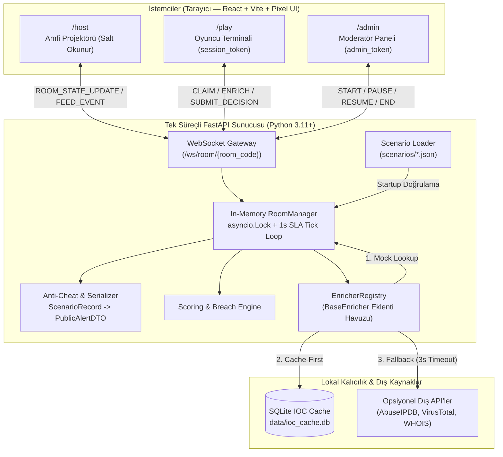
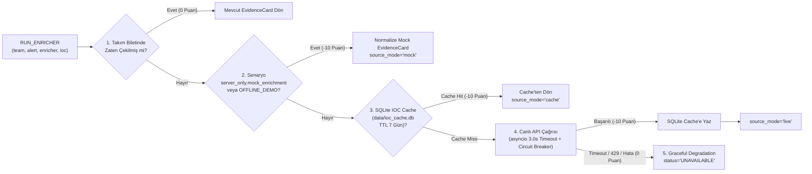

# BreachZero — Sistem Mimarisi (`ARCHITECTURE.md`)

Bu doküman **BreachZero**'nun teknik omurgasını tanımlar. Hedef: 50–100 eşzamanlı oyuncuyu üniversite sunucusunda veya etkinlik dizüstünde **Kubernetes, Kafka veya mikroservis karmaşası olmadan** sıfır yarış durumu (race condition) ve sıfır bilgi sızıntısı ile çalıştırmaktır.

---

## 1. Yalın Tek-Sunucu Sistem Mimarisi

- **Backend:** Python 3.11+, FastAPI, Native WebSockets (bellek içi `RoomManager`), Pydantic v2, SQLite (IOC Cache).
- **Frontend:** React + Vite + TypeScript + Tailwind CSS ([`.agent/skills/pixel-soc-ui/SKILL.md`](../.agent/skills/pixel-soc-ui/SKILL.md) kurallarına kilitli).
- **Senaryo Deposu:** Disk üzerindeki `scenarios/*.json` dosyaları (uygulama açılışında taranır ve doğrulanır).



---

## 2. WebSocket `RoomManager` Yaşam Döngüsü, Claim ve F5 Toleransı

`RoomManager` tüm aktif odaları bellekte (`dict[str, RoomState]`) tutar. Her odanın kendi `asyncio.Lock` nesnesi ve `1 saniyelik` arka plan SLA zamanlayıcı döngüsü (`_sla_tick_loop`) vardır.

```mermaid
sequenceDiagram
    autonumber
    actor P1 as Oyuncu 1 (/play)
    actor P2 as Oyuncu 2 (/play)
    participant WS as FastAPI WS + RoomManager
    actor ADM as Moderatör (/admin)

    P1->>WS: JOIN_ROOM (room_code, team_id, nickname)
    WS-->>P1: SESSION_READY (session_token, active_state)

    par Eşzamanlı Claim Yarışı
        P1->>WS: CLAIM_ALERT (alert_id)
        P2->>WS: CLAIM_ALERT (alert_id)
    end
    Note over WS: asyncio.Lock altında ilk gelen kazanır
    WS-->>P1: ROOM_STATE_UPDATE (alert=CLAIMED by P1)
    WS-->>P2: ERROR (ALERT_ALREADY_CLAIMED)

    P1->>WS: RUN_ENRICHER (alert_id, enricher_id="ip_reputation")
    WS-->>P1: ALERT_ENRICHED (EvidenceCard, -10 puan)

    Note over P1,WS: Oyuncu yanlışlıkla F5 atar (WS bağlantısı kopar)
    WS->>WS: 15s reconnect_grace_timer başlat (bilet hala P1'de)
    P1->>WS: JOIN_ROOM (sessionStorage'daki session_token ile)
    WS->>WS: Grace timer iptal, aynı koltuk ve bilet geri yüklenir
    WS-->>P1: SESSION_READY (mevcut claim &amp; kanıtlar korunur)

    ADM->>WS: ADMIN_PAUSE_WAVE (admin_token)
    Note over WS: Oda durumu PAUSED -> tüm SLA sayaçları donar
    WS-->>P1: ROOM_STATE_UPDATE (status=PAUSED)

    ADM->>WS: ADMIN_RESUME_WAVE (admin_token)
    WS-->>P1: ROOM_STATE_UPDATE (status=ACTIVE)

    P1->>WS: SUBMIT_DECISION (alert_id, decision="TP")
    Note over WS: Yalnızca claim sahibi session_token kabul edilir!
    WS-->>P1: DECISION_RESULT + FEED_EVENT (/host'a yayın)
```

### Kopma Durumu (`> 15 Saniye`)
- Oyuncu `15 saniye` içinde aynı `session_token` ile geri bağlanmazsa sunucu otomatik olarak `AUTO_RELEASE` uygular:
  - Bilet durumu `UNCLAIMED` olur,
  - `claimed_by` temizlenir,
  - Bilette o ana kadar toplanmış olan `evidence_cards` listesi korunur (takımın ödediği sorgu puanı boşa gitmez),
  - Takım üyelerine `ROOM_STATE_UPDATE` ile bildirilir.

---

## 3. Sıfır Güven / Anti-Cheat Sınırları (Server-Authoritative)

Oyuncular siber güvenlik öğrencileri olduğu için `DevTools > Network` veya WebSocket çerçevelerini inceleyecektir. Bu nedenle mimari **tam yetkili sunucu (Server-Authoritative)** ilkesiyle kurulur:

1. **Kesin Model Ayrımı (`ScenarioRecord` vs `PublicAlertDTO`):**
   - Diskten okunan senaryo bellekte tam `ScenarioRecord` olarak saklanır.
   - İstemcilere WebSocket üzerinden yalnızca `PublicAlertDTO` serileştirilir; **`ground_truth`, `hp_penalty_on_miss`, `mitre_attack`, `category`, `required_evidence_hints`, `debrief_explanation` ve `mock_enrichment` ASLA dışarı gönderilmez.**
2. **`session_token` ve `admin_token` Doğrulaması:**
   - İstemci gönderdiği JSON'da `player_id` veya `team_id` uydurarak başkasının adına karar veremez; sunucu her WebSocket bağlantısını o oturuma atadığı 128-bit `session_token` ile eşler.
   - `SUBMIT_DECISION`, `RELEASE_ALERT` ve `RUN_ENRICHER` istekleri yalnızca bileti o an `CLAIM` etmiş `session_token`'dan kabul edilir; aksi halde `NOT_CLAIM_OWNER` döner.
   - `/admin` komutları sunucunun başlangıçta veya oda oluştururken ürettiği `admin_token` olmadan reddedilir.
3. **Sunucu Saatiyle SLA ve Puanlama:**
   - Kalan SLA saniyesi tamamen sunucudaki `_sla_tick_loop` tarafından azaltılır. İstemci yalnızca görsel geri sayım gösterir ve karar payload'ında puan veya süre gönderemez.
4. **Maç Sonu Açıklaması (`MATCH_DEBRIEF`):**
   - Eğitim açıklamaları (`debrief_explanation`, `mitre_attack`, `ground_truth`) yalnızca oda `ENDED` durumuna geçtikten sonra `MATCH_DEBRIEF` mesajıyla yayınlanır.

---

## 4. Rate-Limit Kalkanı (Cache-First + Mock Fallback)

Canlı amfi etkinliğinde 20 takımın aynı anda VirusTotal veya AbuseIPDB ücretsiz API kotasını tüketmesini önlemek için 5 katmanlı bir çözümleme zinciri uygulanır:



- **Cache Pre-Warming CLI:** Etkinlik öncesinde moderatör `python -m app.cache.prewarm --scenarios ../scenarios` komutunu çalıştırarak tüm senaryolardaki harici IOC'leri önceden SQLite önbelleğine çeker. Canlı maç sırasında harici ağa çıkma ihtiyacı neredeyse sıfıra iner.

---

## 5. Bağımsız Modül İzolasyonu (Öğrenci Dostu Yapı)

- **Enricher İzolasyonu:** `EnricherRegistry` her eklentiyi `try/except` ve `asyncio.wait_for(..., timeout=enricher.timeout_seconds)` zırhı içinde çalıştırır. Bir öğrencinin yazdığı eklenti `KeyError` veya `TimeoutError` fırlatsa bile oyun çökmez; ilgili araç `EvidenceCard(status="UNAVAILABLE", summary="Servis şu an yanıt vermiyor.")` döner ve oyuncudan `-10` puan kesilmez.
- **Senaryo Otomatik Keşfi:** Sunucu açılışta `scenarios/*.json` dosyalarını Pydantic v2 `ScenarioFile` modeliyle doğrular. Tek bir dosyada sözdizimi/şema hatası varsa o dosya loglanıp atlanır, geçerli diğer senaryolar sorunsuz yüklenir.

---

## 6. Frontend Görsel Mimarisi (`pixel-soc-ui` Uyumlu)

- Tüm React bileşenleri [`.agent/skills/pixel-soc-ui/SKILL.md`](../.agent/skills/pixel-soc-ui/SKILL.md) ve [`docs/pixel-showcase.html`](./pixel-showcase.html) referanslarına göre inşa edilir:
  - Kilitli renk tokenları (`--bg-crt: #0c0f1d`, `--text-secondary: #b2bfe8` vb.), `border-radius: 0`, `0px` blur gölgeler.
  - Tipografi ayrımı: Saf ASCII/sayılar için `Press Start 2P` (`>= 11px`), Türkçe UI/rozet/mühür için `Pixelify Sans` (`>= 15px`, `weight 500–600`, `letter-spacing: 0.04em`), yoğun IOC/log satırları için `IBM Plex Mono` (`14px`, `line-height: 1.55`).
  - CRT scanline (`rgba(7, 9, 18, 0.10)`) varsayılan kapalı (`scanlines-off`).
  - Tam sayı sprite ölçekleme (`16×2 = 32px`, `16×3 = 48px`, `16×5 = 80px`) ve `icon_id` PNG bulunmayan araçlar için 24×24 `crispEdges` `<rect>`-only SVG fallback.
