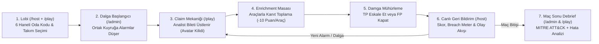

# BreachZero — Oyun Tasarım Dokümanı (GDD)

- **Tür:** Gerçek Zamanlı Çok Oyunculu Pixel-Art SOC Triyaj Simülasyonu (*Papers, Please* × *Overcooked*)
- **Hedef Kitle:** Üniversite siber güvenlik etkinlikleri, atölyeler ve amfi içi takım turnuvaları (50–100 eşzamanlı oyuncu)
- **Görsel Standart:** [`.agent/skills/pixel-soc-ui/SKILL.md`](../.agent/skills/pixel-soc-ui/SKILL.md) ve [`docs/pixel-showcase.html`](./pixel-showcase.html)

---

## 1. Çekirdek Oyun Döngüsü (Core Loop)

Her maç 2–4 dalgadan (wave) oluşur ve ortalama **12–20 dakika** sürer:

---

## 2. Ekran Yapısı ve Kullanıcı Akışları

### A. `/host` — Amfi Projektörü Ekranı (Salt Okunur Vitrin)
- **Oda Bilgisi:** Üst barda dev **6 haneli oda kodu** (örn. `BZ-4821`), aktif dalga numarası (`DALGA 02 / 04`) ve maç durumu (`LOBBY`, `ACTIVE`, `PAUSED`, `ENDED`).
- **Canlı Takım Panelleri:** Her takım için sıra rozeti (`#1`, `#2`, ...), toplam puan, çözülen alarm sayısı ve **10 bloklu parçalı Breach Meter** barı.
- **Olay Akışı (Live Dramatic Feed):** Her yanlış veya kritik karar projektörde anlık haber bandı olarak akar:
  - *"ALPHA SQUAD bir Kerberoasting saldırısını yanlışlıkla kapattı! (-250 Puan, -30 HP)"*
  - *"SİBER KURTLAR kritik C2 alarmını 14 sn içinde eskale etti! (+190 Puan)"*

### B. `/play` — Oyuncu Terminali (Ana Çalışma Masası)
- **Sol / Üst Alan — Ortak Alarm Kuyruğu:** Takıma gelen aktif alarmlar 3 görsel durumda listelenir:
  1. `UNCLAIMED`: Boşta bilet, `[CLAIM]` butonu aktif.
  2. `CLAIMED`: Bileti üstlenen takım arkadaşının **16×16 piksel avatarı** (48×48 ölçekli), kehribar `CLAIMED BY ...` rozeti ve yalnızca sahibine aktif `[RELEASE]` butonu.
  3. `SLA CRITICAL`: Kalan süre toplam SLA'nın **%25'inin** (veya `20s` eşiğinin) altına düştüğünde kırmızı yanıp sönen piksel LED ve alarm sireni.
- **Orta / Sağ Alan — Damga Masası:**
  - Ham OCSF/ECS uyumlu alarm özeti ve kaynak log satırları (`IBM Plex Mono`, yüksek kontrast `#e6ecff`).
  - Dinamik **Enrichment Butonları** (`[IP İTİBAR]`, `[HASH/VT]`, `[İÇ CMDB]`, `[WHOIS]` vb.). Her tıklamada gelen normalize kanıt kartı **Kanıt Günlüğü** terminaline eklenir.
  - Fiziksel çökme animasyonlu iki mühür butonu: **`[FALSE POSITIVE - KAPAT]`** ve **`[TRUE POSITIVE - ESKALE ET]`**.

### C. `/admin` — Moderatör Kontrol Paneli
- **Maç Kurulumu:** `scenarios/` klasöründen otomatik taranan senaryo paketlerini veya dalgaları seçme, oda kodu üretme (`admin_token` korumalı).
- **Canlı Akış Kontrolü:**
  - `ADMIN_START_WAVE`: Sıradaki dalgayı başlatır.
  - `ADMIN_PAUSE_WAVE`: Aktif tüm SLA sayaçlarını sunucu tarafında dondurur; yeni claim/karar işlemlerini kilitler (amfide açıklama yapmak veya teknik aksaklık çözmek için).
  - `ADMIN_RESUME_WAVE`: Donmuş SLA sayaçlarını kaldığı saniyeden devam ettirir.
  - `ADMIN_END_MATCH`: Maçı sonlandırır ve tüm oyunculara gizli `server_only` eğitim özetlerini açar.
- **Maç Sonu Hata Analizi:** Hangi senaryoda hangi takımların False Negative / False Positive hatası yaptığını ve ortalama triyaj sürelerini listeler.

---

## 3. Takım İçi Claim (Üstüne Alma) ve Bağlantı Kuralları

- **Takım Boyutu:** Takım başına **2–4 oyuncu** önerilir.
- **Tekil Sahiplik Kilidi:** Bir oyuncu `[CLAIM]` bastığında sunucu `asyncio.Lock` altında bileti o oyuncunun `session_token`'ına kilitler. Başka bir takım arkadaşı aynı bilete tıklarsa `ALERT_ALREADY_CLAIMED` hatası alır.
- **Yetkili Karar Kuralı:** Sunucu **`SUBMIT_DECISION`**, **`RUN_ENRICHER`** ve **`RELEASE_ALERT`** komutlarını **yalnızca** o bileti o an `CLAIM` etmiş olan `session_token`'dan kabul eder. Claim'siz veya başka oyuncuya ait bir bilette işlem yapmaya çalışan istemci `NOT_CLAIM_OWNER` / `ALERT_NOT_CLAIMED` hatasıyla reddedilir.
- **Manuel Devir (`RELEASE`):** Oyuncu uzmanlık gerektiren veya kararsız kaldığı bileti `[RELEASE]` ile kuyruğa geri bırakabilir; o ana kadar toplanmış olan **Kanıt Günlüğü** verileri takıma ait olarak korunur (aynı araç için tekrar puan kesilmez).
- **F5 Yenileme ve Kopma Toleransı (`15 Saniye`):** Oyuncu yanlışlıkla sayfayı yenilerse (`F5`) veya Wi-Fi kısa süreli kesilirse, tarayıcı `sessionStorage` içinde saklanan `session_token` ile `15 saniye` içinde otomatik yeniden bağlanır (`JOIN_ROOM` + `session_token`) ve elindeki bilet kilidini kaybetmeden devam eder. Oyuncu `15 saniye` içinde dönmezse sunucu bileti otomatik **`AUTO_RELEASE`** ile `UNCLAIMED` durumuna düşürür.

---

## 4. Breach Meter (Şirket Sağlığı) Kuralları

Her takım maça **`100 HP`** (`10 × 10 HP` blok) ile başlar:

| HP Aralığı | Görsel Durum | Kilitli Palet Rengi | Oyun İçi Etki |
| :--- | :--- | :--- | :--- |
| `70 – 100 HP` | `GÜVENLİ` | `#2de370` / `#157a3b` | Normal operasyon |
| `40 – 60 HP` | `RİSK ALTINDA` | `#ffb84d` / `#9c6314` | `/host` ekranında uyarı çerçevesi |
| `10 – 30 HP` | `KRİTİK İHLAL` | `#ff3864` / `#991636` | Yanıp sönen kırmızı kenarlık |
| `0 HP` | `BREACHED` | `#ff3864` (Boş Bar) | Takım elenir; skoru dondurulur, yeni karar veremez |

---

## 5. Matematiksel Puanlama Formülü ve Anti-Exploit Dengesi

### A. Temel Formüller

- **Doğru True Positive (`TP` → `TP`):**
  $$\text{Puan}_{\text{TP}} = \left\lfloor 150 \times M_{\text{seri}} \right\rfloor + \left\lfloor 50 \times \frac{\text{kalan\_sla}}{\text{toplam\_sla}} \right\rfloor$$
- **Doğru False Positive (`FP` → `FP`):**
  $$\text{Puan}_{\text{FP}} = \left\lfloor 100 \times M_{\text{seri}} \right\rfloor + \left\lfloor 40 \times \frac{\text{kalan\_sla}}{\text{toplam\_sla}} \right\rfloor$$
- **Enrichment Sorgu Maliyeti (Takım + Bilet Başına Tek Seferlik):**
  $$\text{Maliyet}_{\text{sorgu}} = -10 \text{ puan (yalnızca başarılı/cache'ten ilk kez dönen araç başına)}$$
  > *Not:* Hata veya `UNAVAILABLE` dönen araçlar `0` puan keser; zaten açılmış kanıtı tekrar okumak ücretsizdir.
- **Seri Çarpanı ($M_{\text{seri}}$):**
  - Ardışık `0–2` doğru: `1.00×`
  - Ardışık `3–4` doğru: `1.25×`
  - Ardışık `5+` doğru: `1.50×`
  *(Seri çarpanı yalnızca pozitif taban puana uygulanır, ceza puanlarını azaltmaz; herhangi bir hata veya SLA aşımında `0` olur.)*

### B. Ceza ve Ödül Matrisi

| Olay / Karar | Gerçek Durum (`ground_truth`) | Oyuncu Kararı | Puan Etkisi | Breach Meter (HP) | Seri |
| :--- | :--- | :--- | :--- | :--- | :--- |
| Doğru Eskalasyon | `TP` | `TP` | `+150` .. `+200` (× seri) | `0 HP` | `+1` |
| Doğru Kapatma | `FP` | `FP` | `+100` .. `+140` (× seri) | `0 HP` | `+1` |
| **False Negative (Kritik Kaçış)** | `TP` | `FP` | **`-250`** | **`-30 HP`** *(senaryo ile `-40 HP`)* | `Sıfırlanır` |
| **False Positive Eskalasyonu** | `FP` | `TP` | **`-80`** | `0 HP` | `Sıfırlanır` |
| **SLA Zaman Aşımı (TP)** | `TP` | *(Yok)* | **`-250`** | **`-30 HP`** *(senaryo ile `-40 HP`)* | `Sıfırlanır` |
| **SLA Zaman Aşımı (FP)** | `FP` | *(Yok)* | **`-40`** | `0 HP` | `Sıfırlanır` |
| Enrichment Araç Kullanımı | — | `RUN_ENRICHER` | **`-10`** | `0 HP` | Değişmez |

### C. Anti-Exploit Matematiksel Kanıt (Örnek Dalga: 8 FP + 2 TP)

FP ağırlıklı bir dalgada suistimal stratejilerinin beklenen net getirisi:

1. **Körlemesine FP Speedrunner ("Her şeyi hemen kapat"):**
   - 8 FP'den hızlı kapatma ile en fazla `8 × 140 = +1120` puan alır (seri bonusu 2. TP hatasında kırılır).
   - 2 TP'yi kaçırdığı için **`2 × (-250) = -500`** puan ve **`-60 HP`** (veya kritiklerde **`-80 HP`**) ağır hasar alır.
   - Bir sonraki dalgada tek bir hata daha yaparsa **`BREACHED`** olup elenir; gerçekçi kanıtlı oynayan takımın gerisinde kalır.
2. **Paranoyak TP Spammer ("Her şeyi eskale et"):**
   - 2 TP'den `+400` puan alır, ancak 8 FP'yi eskale ettiği için **`8 × (-80) = -640`** puan ceza yer.
   - Net skor: **`-240` puan** (tamamen negatif).
3. **Körlemesine Tüm Araçlara Tıklama ("Bilet başı 4 araca bas"):**
   - 10 bilet × 4 araç × `-10` = `-400` puan gereksiz maliyet. Sadece gerekli 1–2 aracı kullanan takım (`-150` maliyet) **`+250` puan** öne geçer.
4. **Dengeli SOC Analisti (Ortalama 2 araç, doğru triyaj):**
   - `8 × 125 + 2 × 180` + seri bonusları `- 20 × 10` = **`+1400`+ puan** ve **`100 HP`** tam sağlık.

---

## 6. V1 MVP vs. V2 Kapsam Ayrımı

| Özellik | V1 (MVP — İlk Turnuva Hedefi) | V2 (Opsiyonel Faz) |
| :--- | :--- | :--- |
| **Ekranlar** | `/host`, `/play`, `/admin` | Replay / turnuva izleyici arşivi |
| **Claim & Reconnect** | Tekil `CLAIM`, `RELEASE`, `15s` F5 reconnect + auto-release | Analist içi kısa not / etiket devri |
| **Enrichment** | `ip_reputation`, `hash_vt`, `internal_cmdb`, `whois` + `BaseEnricher` | DNS passive log, sandbox PCAP özeti |
| **Breach Meter** | 10 bloklu canlı HP, `-30/-40 HP` FN hasarı, `BREACHED` elenme | Takım içi tek seferlik "Yedek Kurtarma" gücü |
| **Rekabetçi Etkileşim** | Canlı `/host` skor & olay akışı, seri çarpanı (`1.25×` / `1.50×`) | **Sabotage:** 5+ seri yakalayan takımın rakip kuyruğa sahte FP gürültü dalgası (`TRIGGER_SABOTAGE`) göndermesi |
| **Maç Sonu Eğitim** | `MATCH_DEBRIEF` ile tüm `server_only` açıklamaları + MITRE ATT&CK | Kulüp içi kalıcı analist profili / rozetler |
